  

  
  
  
  
  
  

  <a href="mailto:sadbin.alam@gmail.com"><b>Email</b></a> ·
  <a href="https://linkedin.com/in/md-sad-bin-alam-turag-477aa7164">LinkedIn</a> ·
  <a href="https://twitter.com/thesturag">X</a> ·
  <a href="https://www.youtube.com/c/thesturag">YouTube</a>

I build business software and data tools. ASP.NET is my home turf (C#, .NET, MSSQL). These days a lot of my back-end work is Go on PostgreSQL, with React and TypeScript on the front. Most of what I ship lives in private repositories, so this page is the guided tour.

- 🔭 **Building:** business software (ERP, billing, inventory) and a web data-extraction platform. See [Right now](#right-now).
- 🌱 **Learning:** Entity Framework, and going deeper with Go and Connect RPC.
- 💬 **Ask me about:** C#, .NET, ASP.NET, MSSQL, Go, PostgreSQL, and still php, angular and networking.
- 📫 **Reach me at:** sadbin.alam@gmail.com

  <b><a href="#right-now">Right now</a></b> ·
  <a href="#stack">Stack</a> ·
  <a href="#public-repos">Public repos</a> ·
  <a href="#github-stats">Stats</a> ·
  <a href="#contact">Contact</a>

## Right now

Click a row to open it. Names are generic on purpose, because the repositories are private.

  

<b>Web data-extraction platform</b> · dashboard, scraping API and docs

 

A scraping and data-extraction product kept in one monorepo: a Next.js dashboard with sign-in, an Elysia API on Bun that drives headless Chromium through Puppeteer, a marketing site, a docs site and Playwright end-to-end tests. It ships in Docker and runs on PostgreSQL and Redis.

`Next.js` `React` `Prisma` `PostgreSQL` `Redis` `Bun` `Elysia` `Puppeteer` `Playwright` `Docker`

<b>Business software</b> · ERP, billing, pharmacy, inventory, ISP

 

| System | What it does | Built with |
| :-- | :-- | :-- |
| **ERP core** | Multi-tenant ERP with a typed RPC API, exact-decimal money handling and a React client | `Go` `Connect RPC` `Protobuf` `PostgreSQL` `React` |
| **Courier billing** | Bookings, carrier rates and costs, invoices, finance reports and staff access, with PDF documents and a multi-language UI | `Go` `chi` `pgx` `PostgreSQL` `React 19` `Vite` `Tailwind` `Playwright` |
| **Pharmacy management** | Pharmacy operations with dashboards, charts and validated forms | `React 19` `Vite` `Tailwind` `Bun` |
| **Shop inventory** | Inventory management for shops, as a web app and a desktop app, with unit and end-to-end tests | `TanStack` `Prisma` `Electron` `Vitest` `Playwright` `Docker` |
| **ISP management** | Management system for internet service providers | `Next.js` `Prisma` `Docker` |

<b>Lead generation and AI-assisted tools</b> · find, score, triage

 

| Tool | What it does | Built with |
| :-- | :-- | :-- |
| **Lead-generation app** | Finds local businesses that need a website or software from open map data, checks each site once, ranks the leads and exports a CSV with the evidence for every row. No account needed; saved leads stay in the browser | `React 19` `TypeScript` `Vite` `Tailwind 4` `Leaflet` `Vercel` |
| **Mail triage** | Pulls mail over IMAP into a local cache and scores each message for spam, priority and recommended action with an AI model. Runs on your own machine | `TanStack Start` `Bun` `TypeScript` |

<b>Products, tools and games</b> · the side of the desk

 

| Project | What it does | Built with |
| :-- | :-- | :-- |
| **Blogging platform** | Fast, private, self-hostable blogs with custom domains, a newsletter and analytics that do not track readers | `TanStack Start` `PostgreSQL` `Drizzle` `Docker Compose` `Caddy` |
| **Image generation API** | Banner and social-card images from templates and a visual editor, with a render cache | `TanStack Start` `Satori` `Skia canvas` `SQLite` |
| **Tab-tidy extension** | A Chromium extension that closes duplicate tabs, groups by site, sorts and merges windows, with no telemetry | `WXT` `TypeScript` `Manifest V3` |
| **Puzzle game** | A browser puzzle with generated, always-solvable levels, rotating boards and moving borders | `React 19` `Vite 8` `Canvas` |
| **Company website** | A marketing site with animated, interactive product demos | `Astro` `Tailwind 4` |

## Stack

Hover an icon for its name, click it for the docs.

<b>Core</b> what I reach for first

<table align="center">
<tr><td align="center" width="120"><a href="https://go.dev" title="Go"> Go</a></td><td align="center" width="120"><a href="https://www.postgresql.org" title="PostgreSQL"> PostgreSQL</a></td><td align="center" width="120"><a href="https://learn.microsoft.com/dotnet/csharp/" title="C#"> C#</a></td><td align="center" width="120"><a href="https://dotnet.microsoft.com/" title=".NET"> .NET</a></td><td align="center" width="120"><a href="https://www.microsoft.com/sql-server" title="MSSQL"> MSSQL</a></td></tr>
</table>

<b>Tried and trusted</b> years of real projects, and I still ship with them when the job calls for it

<table align="center">
<tr><td align="center" width="96"><a href="https://www.php.net" title="PHP"> PHP</a></td><td align="center" width="96"><a href="https://laravel.com/" title="Laravel"> Laravel</a></td><td align="center" width="96"><a href="https://codeigniter.com" title="CodeIgniter"> CodeIgniter</a></td><td align="center" width="96"><a href="https://angular.io" title="Angular"> Angular</a></td><td align="center" width="96"><a href="https://nodejs.org" title="Node.js"> Node.js</a></td><td align="center" width="96"><a href="https://www.mysql.com/" title="MySQL"> MySQL</a></td><td align="center" width="96"><a href="https://www.mongodb.com/" title="MongoDB"> MongoDB</a></td></tr>
<tr><td align="center" width="96"><a href="https://www.w3.org/html/" title="HTML5"> HTML5</a></td><td align="center" width="96"><a href="https://www.w3schools.com/css/" title="CSS3"> CSS3</a></td><td align="center" width="96"><a href="https://getbootstrap.com" title="Bootstrap"> Bootstrap</a></td><td align="center" width="96"><a href="https://jasmine.github.io/" title="Jasmine"> Jasmine</a></td><td align="center" width="96"><a href="https://www.cprogramming.com/" title="C"> C</a></td><td align="center" width="96"><a href="https://www.w3schools.com/cpp/" title="C++"> C++</a></td></tr>
</table>

<b>Shipping with lately</b> front end, tooling and infrastructure

<table align="center">
<tr><td align="center" width="96"><a href="https://www.typescriptlang.org" title="TypeScript"> TypeScript</a></td><td align="center" width="96"><a href="https://react.dev" title="React"> React</a></td><td align="center" width="96"><a href="https://nextjs.org" title="Next.js"><picture><source media="(prefers-color-scheme: dark)" srcset="https://cdn.simpleicons.org/nextdotjs/ffffff"></picture> Next.js</a></td><td align="center" width="96"><a href="https://vite.dev" title="Vite"> Vite</a></td><td align="center" width="96"><a href="https://tailwindcss.com" title="Tailwind"> Tailwind</a></td><td align="center" width="96"><a href="https://bun.sh" title="Bun"> Bun</a></td><td align="center" width="96"><a href="https://redis.io" title="Redis"> Redis</a></td></tr>
<tr><td align="center" width="96"><a href="https://www.prisma.io" title="Prisma"><picture><source media="(prefers-color-scheme: dark)" srcset="https://cdn.simpleicons.org/prisma/ffffff"></picture> Prisma</a></td><td align="center" width="96"><a href="https://www.docker.com" title="Docker"> Docker</a></td><td align="center" width="96"><a href="https://playwright.dev" title="Playwright"> Playwright</a></td><td align="center" width="96"><a href="https://www.electronjs.org" title="Electron"> Electron</a></td><td align="center" width="96"><a href="https://astro.build" title="Astro"> Astro</a></td><td align="center" width="96"><a href="https://vercel.com" title="Vercel"><picture><source media="(prefers-color-scheme: dark)" srcset="https://cdn.simpleicons.org/vercel/ffffff"></picture> Vercel</a></td><td align="center" width="96"><a href="https://git-scm.com" title="Git"> Git</a></td></tr>
</table>

Also: Entity Framework, Connect RPC, Protobuf, Drizzle, Caddy, Vitest.

## Public repos

Nearly everything above is private. These two are open, if you would like to read real code.

| Repo | What it is | Built with |
| :-- | :-- | :-- |
| [reddit-helper](https://github.com/dataautomators/reddit-helper) | A Chrome extension that adds an AI summary to Reddit posts, with related-post search and support for local or OpenAI-compatible models | `Plasmo` `React` `TypeScript` |
| [bulk-duckduckgo-search-tool](https://github.com/dataautomators/bulk-duckduckgo-search-tool) | A simple UI for running many DuckDuckGo searches at once, with filtering and a queue | `Next.js` `TypeScript` `Redis` |

## GitHub stats

  <a href="https://github.com/thesturag">
    <picture>
      <source media="(prefers-color-scheme: dark)" srcset="https://github-readme-stats.vercel.app/api?username=thesturag&amp;show_icons=true&amp;hide_border=true&amp;bg_color=0d1117&amp;title_color=58a6ff&amp;icon_color=58a6ff&amp;text_color=c9d1d9">
      
    </picture>
  </a>
   
  Public activity only. Most of my work is in private repositories, so this card undercounts.

## Contact

Ask me about C#, .NET, ASP.NET, MSSQL, Go, PostgreSQL, or php, angular and networking. I read my email.

  
  
  
  
  
  

Thanks for stopping by.

